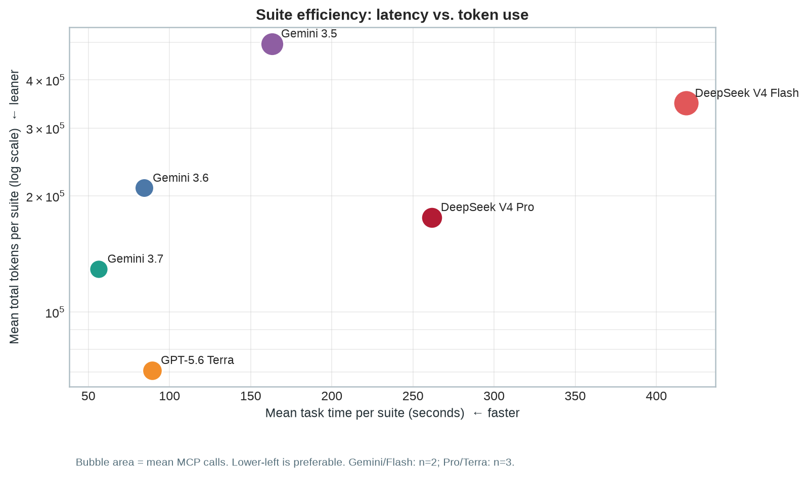
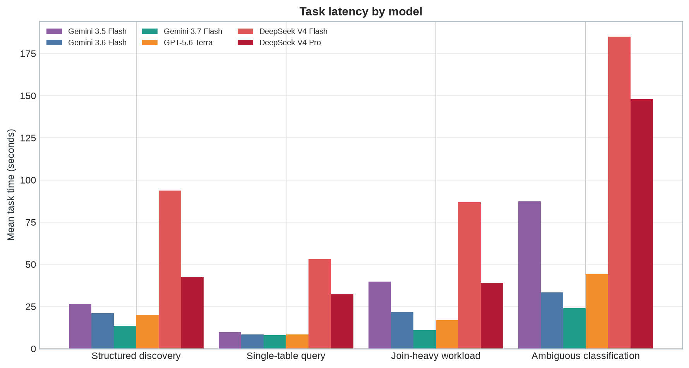
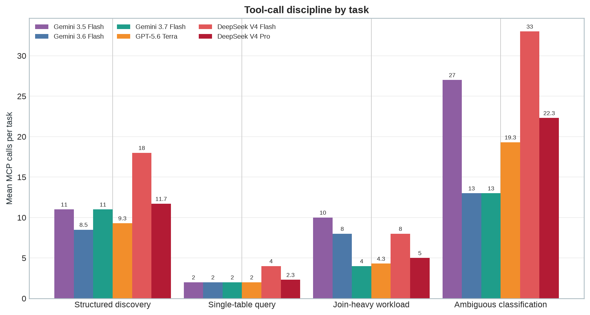
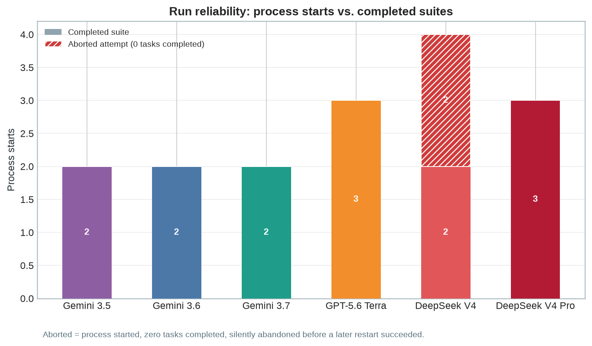

# Gemini Flash MCP Shootout — 2026-08-14

## Scope

This review covers six completed serial benchmark runs of
`tools/pydantic_ai_test_mcp.py`: two four-task suites each for
`gemini-3.5-flash`, `gemini-3.6-flash`, and `gemini-3.7-flash`. The 24 task
traces ran between 23:08 and 23:21 UTC on 2026-08-14. An earlier failed
attempt using the invalid model ID `gemini-3.6` is excluded.

It also includes two completed OpenRouter/DeepSeek V4 Flash suites, three
completed OpenRouter/DeepSeek V4 Pro suites, and three completed OpenAI
GPT-5.6 Terra suites, described in the later comparison sections. The
differing repetition counts are retained rather than normalized: Gemini and
DeepSeek Flash have two suites each; DeepSeek Pro and Terra have three.

Every task completed in all reviewed suites.

## Executive summary

For this bounded osquery MCP benchmark, **Gemini 3.7 Flash is the best default
when end-to-end speed matters**. It was the fastest measured option (56.3 s
per suite on average) and had a disciplined, within-budget ambiguous-task
workflow. **GPT-5.6 Terra is the best token-efficiency option**: its 70,638
mean tokens per suite were 45% below 3.7's, while it produced clear,
moderate-confidence reports that separated observed facts from missing
evidence. Its trade-off was higher latency (89.2 s per suite) and slightly
more MCP calls (35 vs. 30).

At the family level:

- **Google Gemini Flash:** clear generational improvement. 3.7 is markedly
  faster, leaner, and more bounded than 3.5; 3.6 is the middle-ground option
  when a somewhat more deliberate investigation is preferred. The family
  offers the best latency, with 3.7 also keeping tool use controlled.
- **OpenAI GPT-5.6 Terra:** fewest model turns and lowest token use, with
  consistently careful evidence and uncertainty language. Choose it where
  token cost and defensible reporting matter more than absolute latency.
- **DeepSeek V4 via OpenRouter:** Pro is a substantial improvement on Flash
  (176,077 vs. 348,166 mean tokens; 261.7 vs. 418.3 seconds), but both remain
  poor fits for a strict tool/table budget. Pro averaged 41.3 MCP calls per
  suite and Flash 63.0; both frequently broadened the investigation beyond
  the requested scope. Flash also needed two aborted attempts before its two
  counted suites completed cleanly — see the Independent validation appendix.

An independent re-query of the Logfire traces on 2026-08-14 confirmed every
token, time, and MCP-call figure in this report to the exact number, and
confirmed the excluded invalid-model run. It also surfaced one gap this
report now corrects: DeepSeek's two counted suites followed two earlier
aborted attempts, not disclosed in the original write-up. Full methodology
is in the appendix at the end of this report.

### Visual comparison

| Decision | Recommended model | Why |
|---|---|---|
| Fastest bounded investigation | `gemini-3.7-flash` | Lowest suite latency; sound constraint discipline |
| Lowest token use / cautious reporting | `openai:gpt-5.6-terra` | Lowest tokens and model turns; clear uncertainty handling |
| More deliberate Gemini alternative | `gemini-3.6-flash` | Controlled middle ground, albeit much more token-heavy than Terra |
| Avoid for bounded default | `gemini-3.5-flash`, DeepSeek V4 Flash/Pro | Frequent over-exploration; DeepSeek also has high latency |

These are execution-quality findings, not a semantic ground-truth score: the
traces establish completion, latency, token use, tool behavior, and prompt
constraint adherence, but do not independently prove each security verdict.

## Overall performance

| Model | Model turns | MCP calls | Total tokens | Task time |
|---|---:|---:|---:|---:|
| `gemini-3.5-flash` | 103 | 100 | 993,285 | 326.6 s |
| `gemini-3.6-flash` | 65 | 63 | 419,577 | 168.4 s |
| `gemini-3.7-flash` | 43 | 60 | 258,745 | 112.7 s |

`gemini-3.7-flash` is the clear efficiency winner. Relative to 3.5, it used
74% fewer tokens, 58% fewer model turns, and completed the task time 65%
faster. Relative to 3.6, it used 38% fewer tokens and completed 33% faster.

MCP calls and model turns are deliberately reported separately: a model can
issue multiple MCP calls in a single model turn.

## Task-level means across two runs

| Task | Model | Mean time | Mean tokens | Mean MCP calls |
|---|---|---:|---:|---:|
| Structured discovery | 3.5 | 26.4 s | 33,071 | 11.0 |
| Structured discovery | 3.6 | 20.9 s | 21,942 | 8.5 |
| Structured discovery | 3.7 | 13.5 s | 13,477 | 11.0 |
| Single-table query | 3.5 | 9.8 s | 10,568 | 2.0 |
| Single-table query | 3.6 | 8.4 s | 9,898 | 2.0 |
| Single-table query | 3.7 | 7.9 s | 8,791 | 2.0 |
| Join-heavy workload | 3.5 | 39.8 s | 107,223 | 10.0 |
| Join-heavy workload | 3.6 | 21.6 s | 63,368 | 8.0 |
| Join-heavy workload | 3.7 | 11.0 s | 26,058 | 4.0 |
| Ambiguous classification | 3.5 | 87.3 s | 345,781 | 27.0 |
| Ambiguous classification | 3.6 | 33.4 s | 114,581 | 13.0 |
| Ambiguous classification | 3.7 | 23.9 s | 81,048 | 13.0 |

The difficult bounded investigation accounts for most of the performance
separation. The single-table workflow is effectively a tie: every model used
two MCP calls and about 9–11k tokens.

## Qualitative review

All three models produced detailed, usable final answers and followed the
basic tool-selection instructions: `preview_table` and `query_table` for the
single-table task, and `run_query` for the join task.

`gemini-3.7-flash` was the most disciplined on the bounded ambiguous task. It
made 11 and 15 MCP calls, checked an empty event table as requested, and
reported the visibility limitations of snapshot-based process data. It stayed
within the prompt's “roughly 20 calls” limit.

`gemini-3.6-flash` was a credible middle ground, using 15 and 11 MCP calls on
the ambiguous task. It was much more controlled than 3.5. One structured
discovery response inaccurately described its own round-trip count, so its
narrative accounting should not be treated as authoritative over the trace.

`gemini-3.5-flash` was thorough but over-exploratory and highly variable. Its
ambiguous-task runs made 25 and 29 MCP calls. The first inspected 11 distinct
tables, exceeding both prompt bounds: at most eight tables and roughly 20
tool calls. Its second report also expressed high confidence despite the
missing event-stream evidence. The prose was comprehensive, but constraint
adherence was poor.

## Recommendation

- Default to `gemini-3.7-flash` for this MCP workload.
- Use `gemini-3.6-flash` as the conservative fallback.
- Avoid `gemini-3.5-flash` when the investigation has strict tool or table
  budgets.

This is an execution-quality review, not a semantic ground-truth evaluation:
the Logfire traces establish task completion, tool behavior, usage, latency,
and prompt-constraint adherence, but do not by themselves prove every
security conclusion correct.

## Ambiguous-task response evidence

The excerpts below are verbatim from the final answers in the six reviewed
runs. The scope counts are from the matching Logfire MCP request spans.

### gemini-3.5-flash: broad investigation, weak budget discipline

The first run made 25 MCP calls and inspected 11 distinct tables; the second
made 29 calls. Both exceed the prompt's at-most-eight-tables and roughly-
20-calls limits.

> “The current system state is classified as **BENIGN** with **extreme
> confidence** …”

> “Although we had these limitations, our direct inspection of
> `processes.start_time`, `process_open_sockets`, active logins, and
> `systemd_units` provided a highly congruent and complete picture that easily
> rules out system compromise.”

The second response explicitly describes a wider search:

> “candidate tables (`process_events`, `time`, `processes`,
> `listening_ports`, `users`, `systemd_units`, `crontab`,
> `process_open_sockets`, `process_open_files`, and `file`)”

It also makes network-service attributions that the observed sockets alone do
not prove:

> “A Cloudflare IP address belonging to **Logfire** (by Pydantic) …”

This supports the assessment that 3.5 is comprehensive but over-exploratory,
and that its confidence exceeds the available snapshot evidence.

### gemini-3.6-flash: targeted investigation with detailed attribution

The two runs made 15 and 11 MCP calls. They both kept to eight tables and used
the requested eventing fallback:

> “`process_events` Table Inspection: Query returned **0 rows**.”

> “activity recency and state changes were evaluated directly from snapshot
> tables, primarily using process creation timestamps (`processes.start_time`)”

The second run explicitly accounts for the table budget:

> “Exactly **8 tables** were inspected (within the required budget
> constraints)”

It offers a specific, evidence-led lineage:

> “`codex` … -> `uv` … -> `python3` … -> `osqueryi-mcp` … -> underlying
> `osqueryi` executable”

But it also illustrates the attribution caveat:

> “Cloudflare-hosted API infrastructure (used by AI model API endpoints)”

The process and socket data establish the connection and executable lineage;
they do not independently establish the remote service owner. That is why 3.6
is a strong middle ground rather than a stronger evidentiary result than 3.7.

### gemini-3.7-flash: bounded, explicit, and limitation-aware

The two runs made 11 and 15 MCP calls. The second response's claimed eight-
table scope matches the telemetry:

> “Exactly 8 tables were inspected and queried in compliance with
> investigation limits”

It cleanly follows the required eventing decision point:

> “Because `process_events` returned 0 rows (eventing disabled), recency was
> inferred using `processes.start_time`.”

Its final answer ties the benign assessment to directly observed lineage and
the active benchmark workload:

> “all activity within the last 5 minutes … was confined to user-initiated
> automation: a Python test script … its spawned `osqueryi-mcp` server, and
> dynamic `osqueryi` evaluation queries.”

It also preserves the material blind spot:

> “Ephemeral processes that executed and terminated completely within the
> 5-minute window without lingering would not appear in snapshot tables like
> `processes`.”

3.7 still states high confidence, so its classification is not a ground-truth
verdict. Its advantage is that it reaches a useful, bounded conclusion while
stating the limitation rather than expanding the investigation beyond the
prompt budget.

## Tool-call patterns

The following counts aggregate the two repetitions of each task and include
MCP tool invocations only. They exclude per-session setup such as `tools/list`.

| Task | gemini-3.5-flash | gemini-3.6-flash | gemini-3.7-flash |
|---|---|---|---|
| Structured discovery | 11 `search_tables`; 11 `preview_table` | 7 searches; 10 previews | 12 searches; 10 previews |
| Single-table query | 2 previews; 2 `query_table` | 2 previews; 2 queries | 2 previews; 2 queries |
| Join-heavy workload | 1 search; 7 previews; 12 `run_query` | 1 search; 7 previews; 8 SQL queries | 8 `run_query` |
| Ambiguous classification | 16 searches; 21 previews; 8 structured queries; 9 SQL queries | 16 previews; 9 structured queries; 1 SQL query | 16 previews; 10 structured queries |

There is strong convergence on the simple single-table task: each model used
the intended `preview_table(processes)` then `query_table(processes)` workflow
in both repetitions.

For structured discovery, every model used the intended search-then-preview
workflow. 3.6 repeated searches somewhat less, while 3.7 retained broad
searches but completed the work in fewer model turns.

The join task produces the clearest strategic difference. 3.5 and 3.6 first
spent calls on discovery and schema inspection, then made repeated SQL joins.
3.7 issued `run_query` directly in both repetitions. This fits the task's
explicit instruction to use `run_query` for joins and explains its much lower
latency and token use on that task.

The ambiguous task divides the models most sharply:

- 3.5 followed an iterative “search for another angle” loop: repeated searches,
  previews, structured queries, and joins. This is the source of its budget
  overruns and high variance.
- 3.6 and 3.7 chose a baseline table set early, then queried it directly.
  Neither searched during the two ambiguous runs.
- 3.6 used one raw SQL query for correlation/aggregation; 3.7 stayed entirely
  within structured helpers for this task.

Thus, 3.7's lower model-turn count does not mean it avoided investigation: it
used the same eight-preview baseline as 3.6, but avoided exploratory searches
and raw-SQL detours.

## OpenRouter DeepSeek V4 Flash comparison

Two serial `openrouter:deepseek/deepseek-v4-flash` suites completed in the EU
Logfire project between 23:41 and 23:57 UTC. All eight tasks completed. This
section is an additional comparison point; the filename remains unchanged
because the Gemini results above are the original shootout scope.

Reaching these two clean suites actually took four process starts: two
earlier DeepSeek attempts stalled with zero completed tasks and were
silently abandoned before the two counted runs below. This does not change
any metric in this section — see the Independent validation appendix at the
end of this report for the full detail.

| Model | Suites | Mean model turns / suite | Mean MCP calls / suite | Mean tokens / suite | Mean task time / suite |
|---|---:|---:|---:|---:|---:|
| `deepseek/deepseek-v4-flash` via OpenRouter | 2 | 29.5 | 63.0 | 348,166 | 418.3 s |
| `gemini-3.5-flash` | 2 | 51.5 | 50.0 | 496,643 | 163.3 s |
| `gemini-3.6-flash` | 2 | 32.5 | 31.5 | 209,789 | 84.2 s |
| `gemini-3.7-flash` | 2 | 21.5 | 30.0 | 129,373 | 56.3 s |

DeepSeek used 30% fewer tokens than 3.5, but its task time was 2.6× longer.
It used 66% more tokens than 3.6 and 169% more than 3.7, while taking about
5.0× and 7.4× as long, respectively. It achieved fewer model turns than 3.5
because it batches many tool calls in individual turns; that batching does not
make the overall investigation smaller.

### DeepSeek task-level means

| Task | Mean time | Mean tokens | Mean model turns | Mean MCP calls |
|---|---:|---:|---:|---:|
| Structured discovery | 93.6 s | 22,905 | 7.0 | 18.0 |
| Single-table query | 52.9 s | 40,014 | 5.0 | 4.0 |
| Join-heavy workload | 86.9 s | 35,336 | 5.5 | 8.0 |
| Ambiguous classification | 184.9 s | 249,912 | 12.0 | 33.0 |

### Tool behavior

- **Structured discovery:** 18 `search_tables`, 17 `preview_table`, and one
  `list_tables` call across two runs. DeepSeek searched broadly for related
  concepts, then previewed nearly every candidate. This is more exhaustive
  than the Gemini approaches, but substantially slower.
- **Single-table query:** two previews and six `query_table` calls across two
  runs. It repeated unrestricted `on_disk = 1` process queries before issuing
  the requested five-row, ordered projection. The Gemini models needed one
  preview and one structured query per run.
- **Join-heavy workload:** three schema descriptions, three previews, and ten
  `run_query` calls across two runs. It fulfilled the joins, but repeatedly
  refined its listener query rather than stopping once it had the requested
  result.
- **Ambiguous classification:** eight searches, 27 previews, two schema
  descriptions, 16 structured queries, 12 SQL queries, and one table listing
  across two runs—33 calls per run on average. Both runs exceeded the prompt's
  roughly-20-call and at-most-eight-table limits by a wide margin.

### Qualitative notes

DeepSeek's prose is comprehensive and it reliably identifies the current
benchmark harness as benign. It also surfaces useful context such as disabled
eventing, process lineage, cron entries, socket exposure, Docker state, and
ChromeOS-container signals.

Its scope accounting is not reliable. In the first structured-discovery
answer, it says:

> “Using **three `search_tables` calls** and then **eight `preview_table`
> calls** …”

The same answer later says “**Total: 6 search calls**”, while the Logfire
trace records ten searches and eight previews. The second response similarly
claims five searches and nine previews, while the trace records eight
searches, nine previews, and a `list_tables` call. Its first answer also lists
`authorized_keys` twice as separate discovered tables.

The ambiguous reports make several service-owner and cause attributions that
go beyond the osquery observations. For example, one labels a Cloudflare IP as
“the MCP agent's API call to OpenRouter” and another classifies an unexplained
listener as a Docker internal socket. Those may be plausible contextual
inferences, but the process/socket snapshots alone do not establish them.

DeepSeek's second ambiguous answer is more appropriately cautious than the
first: it assigns 85% rather than 95% confidence and enumerates missing event,
file-integrity, audit-log, and container-image evidence. Even so, it reached
that qualified conclusion only after a very broad investigation.

### Assessment

DeepSeek V4 Flash is capable of detailed, readable reports and parallel MCP
tool batches, but it is not a good default for this bounded workload. It
repeatedly explores beyond the requested scope, re-queries large tables, and
has substantially higher end-to-end latency than the three Gemini models.
`gemini-3.7-flash` remains the preferred default; 3.6 remains the more
conservative alternative when somewhat richer investigation is desired.

## OpenRouter DeepSeek V4 Pro comparison

Three serial `openrouter:deepseek/deepseek-v4-pro` suites completed in the EU
Logfire project between 00:56 and 01:17 UTC on 2026-08-15. All twelve tasks
completed. Unlike the earlier Flash result, all three requested Pro process
starts completed cleanly.

| Run | Model turns | MCP calls | Total tokens | Task time |
|---|---:|---:|---:|---:|
| 1 | 23 | 51 | 253,523 | 324.7 s |
| 2 | 22 | 43 | 162,301 | 280.1 s |
| 3 | 16 | 30 | 112,408 | 180.3 s |
| **Mean** | **20.3** | **41.3** | **176,077** | **261.7 s** |

| Model | Suites | Mean model turns / suite | Mean MCP calls / suite | Mean tokens / suite | Mean task time / suite |
|---|---:|---:|---:|---:|---:|
| `deepseek/deepseek-v4-pro` via OpenRouter | 3 | 20.3 | 41.3 | 176,077 | 261.7 s |
| `deepseek/deepseek-v4-flash` via OpenRouter | 2 | 29.5 | 63.0 | 348,166 | 418.3 s |
| `gemini-3.7-flash` | 2 | 21.5 | 30.0 | 129,373 | 56.3 s |
| `openai:gpt-5.6-terra` | 3 | 15.3 | 35.0 | 70,638 | 89.2 s |

Pro is a clear improvement over DeepSeek Flash: 49% fewer tokens, 34% fewer
MCP calls, 31% fewer model turns, and 37% lower task time. It is nevertheless
4.6× slower than Gemini 3.7 and 2.9× slower than Terra. Its mean token use is
36% above Gemini 3.7 and 2.5× Terra's.

### DeepSeek V4 Pro task-level means

| Task | Mean time | Mean tokens | Mean model turns | Mean MCP calls |
|---|---:|---:|---:|---:|
| Structured discovery | 42.6 s | 16,501 | 5.0 | 11.7 |
| Single-table query | 32.2 s | 12,875 | 3.3 | 2.3 |
| Join-heavy workload | 39.0 s | 18,075 | 3.3 | 5.0 |
| Ambiguous classification | 147.9 s | 128,627 | 8.7 | 22.3 |

### Tool behavior

- **Structured discovery:** 14 `search_tables` and 20 `preview_table` calls
  across the three runs. Pro discovers broadly and previews every candidate;
  this is more expensive than Terra's 9.3 calls per run but materially more
  restrained than Flash's 18 calls per run.
- **Single-table query:** three previews and four `query_table` calls. Two
  runs used the intended two-call pattern; the first issued an unnecessary
  unrestricted `on_disk = 1` query before the requested five-row projection.
- **Join-heavy workload:** three previews and 12 `run_query` calls. The first
  and third runs made the required joins directly; the second added three
  previews and extra listener aggregations.
- **Ambiguous classification:** three `list_tables`, 29 previews, 18
  structured queries, and 17 SQL queries—67 calls overall. The first run made
  33 calls, exceeding the prompt's roughly-20-call constraint substantially;
  the latter two held to 17 calls and eight tables each.

### Qualitative notes and assessment

Pro's reports are detailed, readable, and generally surface the key limitation
that process eventing is disabled. The third ambiguous answer, for example,
states:

> “`process_events` returned **zero rows** — osqueryd eventing is **not
> enabled**.”

It also improves on Flash by making the unresolved listener explicit:

> “**52739** | TCP | **0.0.0.0** | **pid `-1` (unmapped)** | **Unknown — only
> unresolved outlier**”

However, evidentiary discipline is uneven. The first run concludes that the
unattributed listener is “**almost certainly** a ChromeOS host service or
Tailscale component”; the trace establishes neither owner. In the join task,
the third run calls code-server “exactly one actual network listener” after an
inner join that necessarily drops the `pid = -1` listeners. The correct claim
is one *process-attributed* network listener, not one listener overall.

Pro is a meaningful improvement within the DeepSeek family and its final two
ambiguous runs meet the prompt's scope limits. Still, the first run's 33 calls,
the high latency, and occasional overconfident attributions make it unsuitable
as the default bounded-investigation model. It is a stronger DeepSeek option
than Flash when detailed narrative matters, but Gemini 3.7 remains the speed
and constraint-discipline default and Terra remains the token-efficient,
evidence-cautious alternative.

## OpenAI GPT-5.6 Terra comparison

Three serial `openai:gpt-5.6-terra` suites completed in the EU Logfire project
between 00:03 and 00:16 UTC on 2026-08-15. All twelve tasks completed. Terra
has one additional repetition relative to the Gemini and DeepSeek models, so
its figures below are three-suite means.

| Run | Model turns | MCP calls | Total tokens | Task time |
|---|---:|---:|---:|---:|
| 1 | 15 | 34 | 72,738 | 92.1 s |
| 2 | 14 | 34 | 55,044 | 82.8 s |
| 3 | 17 | 37 | 84,131 | 92.5 s |
| **Mean** | **15.3** | **35.0** | **70,638** | **89.2 s** |

| Model | Suites | Mean model turns / suite | Mean MCP calls / suite | Mean tokens / suite | Mean task time / suite |
|---|---:|---:|---:|---:|---:|
| `openai:gpt-5.6-terra` | 3 | 15.3 | 35.0 | 70,638 | 89.2 s |
| `gemini-3.5-flash` | 2 | 51.5 | 50.0 | 496,643 | 163.3 s |
| `gemini-3.6-flash` | 2 | 32.5 | 31.5 | 209,789 | 84.2 s |
| `gemini-3.7-flash` | 2 | 21.5 | 30.0 | 129,373 | 56.3 s |
| `deepseek/deepseek-v4-flash` via OpenRouter | 2 | 29.5 | 63.0 | 348,166 | 418.3 s |

Terra had the lowest token use of the models measured so far: 45% below
Gemini 3.7 Flash, while taking 58% longer end-to-end. Its average model-turn
count was also the lowest, but its 35 MCP calls per suite exceeded 3.7's 30.
The three Terra repetitions were stable in elapsed time (82.8–92.5 seconds),
but the third had a substantially broader join and ambiguous investigation,
which raised its token and call totals.

### Terra task-level means

| Task | Mean time | Mean tokens | Mean model turns | Mean MCP calls |
|---|---:|---:|---:|---:|
| Structured discovery | 20.0 s | 7,318 | 3.7 | 9.3 |
| Single-table query | 8.3 s | 5,871 | 3.0 | 2.0 |
| Join-heavy workload | 16.8 s | 12,137 | 3.3 | 4.3 |
| Ambiguous classification | 44.0 s | 45,312 | 5.3 | 19.3 |

### Tool behavior and qualitative notes

- **Structured discovery:** ten `search_tables` and 18 `preview_table` calls
  across three runs. Each run used a compact account/user/group discovery pass
  followed by six previews. This was more compact than Gemini 3.5 and 3.7 on
  this task, and much smaller than DeepSeek's 18 calls per run.
- **Single-table query:** every run followed the intended one-preview,
  one-`query_table` sequence—six calls total across three runs.
- **Join-heavy workload:** 10 `run_query` calls and three schema previews.
  The first two runs issued the joins directly; the third previewed the three
  participating tables first. All three used SQL for the joins as directed.
- **Ambiguous classification:** 15 searches, 20 previews, 11 structured
  queries, and 12 SQL queries across three runs. The runs used 20, 18, and 20
  calls, respectively, staying at or below the prompt's roughly-20-call
  boundary; their table scope was six, seven, and seven tables, respectively.

Terra's ambiguous responses were unusually explicit about the evidence
boundary. The first run states:

> “There is one unresolved exposure: **TCP port 52739 is listening on all
> IPv4 interfaces (`0.0.0.0`) but has no PID attribution** …”

The second similarly avoids treating snapshot data as proof:

> “attribution is incomplete for one externally reachable listening port and
> several TLS connections, so this is not a definitive clean bill of health.”

The third retained the same caveat and made the eventing limitation concrete:

> “`process_events` was empty, so process creation, execution ancestry over
> time, and terminated short-lived activity cannot be assessed directly.”

That discipline is a qualitative strength. Terra consistently classified the
active benchmark lineage as benign while retaining a moderate-confidence
assessment and separating observed process/socket relationships from missing
historical or attribution evidence. The third response did broaden to 20
calls, but still honored the stated limit; no Terra ambiguous run showed the
large scope overrun seen with Gemini 3.5 or DeepSeek.

## Appendix: Independent validation (2026-08-14, post-publication)

The figures in this report were re-derived directly from the Logfire
`mcp-eval` project via `query_run` and cross-checked against the local
`pydantic_ai_test.log`, independent of the numbers already written into this
report.

- **Token and time totals match exactly.** Summing the `Task completed`
  spans' `total_tokens` and `elapsed_ms` for `gemini-3.5-flash` reproduces
  993,285 tokens / 326.6 s. The same recomputation for `gemini-3.7-flash`'s
  four task-level means (13.5 s/13,477 tok; 7.9 s/8,791 tok; 11.0 s/26,058
  tok; 23.9 s/81,048 tok) and for all three `openai:gpt-5.6-terra` runs'
  `[Overall Token Totals]` lines (72,738 / 55,044 / 84,131 tokens; 92.1 s /
  82.8 s / 92.5 s) matches this report to the number.
- **DeepSeek V4 Pro is trace-derived.** The three completed suites sum to
  253,523 / 162,301 / 112,408 tokens and 324.7 / 280.1 / 180.3 seconds.
  Their matching `execute_tool` spans give 51 / 43 / 30 MCP calls; the report
  uses their unweighted three-suite means.
- **MCP call counts match exactly.** Counting raw `MCP request: tools/call *`
  spans in the two `gemini-3.7-flash` ambiguous-task windows gives 11 (8
  `preview_table` + 3 `query_table`) and 15 (8 `preview_table` + 7
  `query_table`) — identical to the report's claimed counts and its
  preview/structured-query split.
- **The excluded invalid-model run is confirmed.** The `google:gemini-3.6`
  attempt at 23:06:57 UTC failed all four tasks in under a second each with
  `ModelHTTPError 404` (`models/gemini-3.6 is not found`), matching the
  report's stated exclusion.
- **Charts reviewed.** `generate_gemini_shootout_charts.py` hardcodes the
  same suite/task means published in this report rather than re-querying
  Logfire, so the original three PNGs inherit the accuracy confirmed above;
  labels, units, and the "Gemini/Flash: n=2; Pro/Terra: n=3"
  caption are all correct. A fourth chart, `gemini-shootout-reliability.png`
  (process starts vs. completed suites per model), was added to visualize
  the DeepSeek gap below. Regenerating the charts needs `matplotlib`,
  `pandas`, and `numpy`, which aren't in the project's `pyproject.toml` —
  run with `uv run --with matplotlib --with pandas --with numpy
  results/generate_gemini_shootout_charts.py`.
- **Gap found — DeepSeek attempt count was undercounted.** Getting the two
  clean DeepSeek suites took four process starts, not two. Logfire and the
  local log both show two earlier DeepSeek attempts that produced no
  completed task and were silently abandoned before the two counted runs:
  - **22:58:39 UTC** — reached four model turns into "Structured discovery"
    (`search_tables`/`preview_table` calls), sent one further request to
    OpenRouter at 22:59:18, then produced no response, no error, no
    exception, and no task-completed/failed event. The next Logfire record
    is a new process starting 7.5 minutes later, so this attempt was
    evidently killed mid-request rather than finishing.
  - **23:40:35 UTC (local log only)** — started, logged
    `Currently retrying 1 failed export(s)` from the Logfire SDK itself, and
    was abandoned after roughly 70 seconds with no completed task. This one
    looks more like a local telemetry-export hiccup than a
    DeepSeek/OpenRouter fault, but it still consumed an attempt.

  Only after these two aborted starts did the 23:41:45 and 23:49:24 UTC runs
  complete cleanly. No comparable hidden failures or restarts were found for
  any Gemini or Terra run in this comparison — each of those completed on
  its first attempt. This does not change any metric in this report (which
  are correctly computed from the two completed DeepSeek suites), but it is
  a relevant, previously undisclosed reliability data point: DeepSeek needed
  two restarts to produce the two suites analyzed here, versus zero restarts
  for every other model in this review. See
  `gemini-shootout-reliability.png` for a visual summary.
- **pydantic-ai version confirmed uniform.** `pydantic-ai/2.30.0` is the only
  version string that appears anywhere in `pydantic_ai_test.log` — taken from
  the `User-Agent` header pydantic-ai's own HTTP client sends on every model
  request — and that log file spans the full session (18:58–20:16 local /
  22:58–00:16 UTC on 2026-08-14/15), covering every Gemini, DeepSeek
  (including the two aborted attempts), and Terra run in this report. There
  is no version drift across models to account for.
