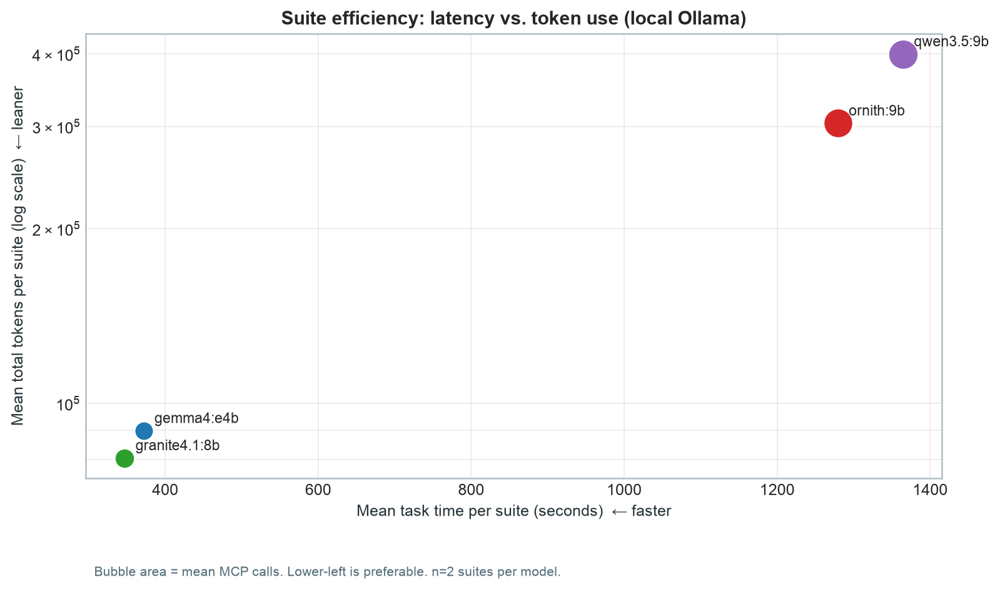
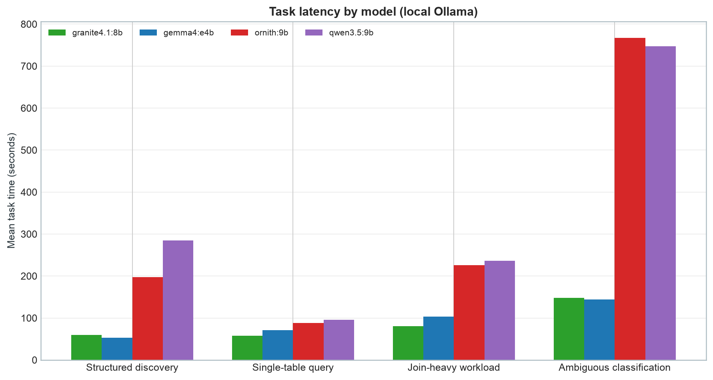
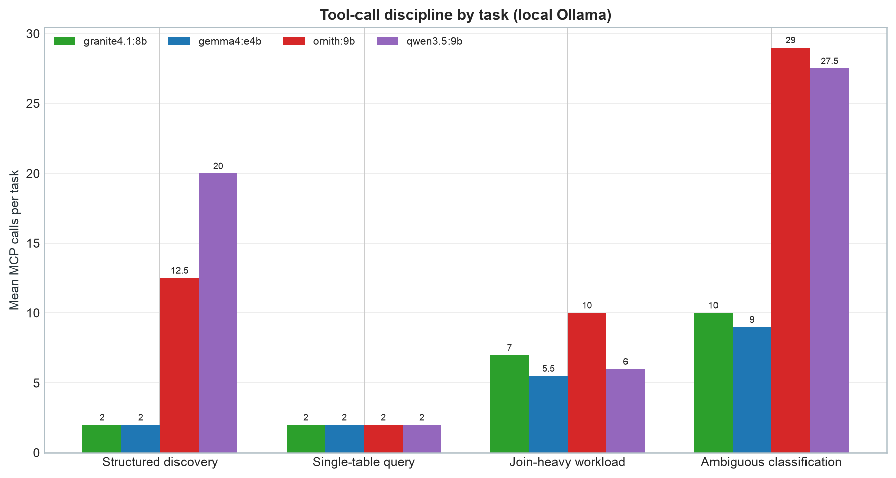

# Local Ollama MCP Shootout — 2026-08-16

## Scope

This review covers eight completed serial four-task suites of
`tools/pydantic_ai_test_mcp.py` against a local Ollama server (Apple M4 Mini,
24GB unified memory, `OLLAMA_CONTEXT_LENGTH=32768`): two suites each for
`granite4.1:8b`, `ornith:9b`, `gemma4:e4b`, and `qwen3.5:9b`. The first three
models' 24 task traces ran between 11:51 and 12:58 UTC on 2026-08-16
(07:51–08:58 local); `qwen3.5:9b`'s 8 task traces ran separately, between
15:27 and 16:07 UTC the same day (11:27–12:07 local), after the other three
were already written up. Both batches used the same
`OLLAMA_CONTEXT_LENGTH=32768` server configuration. All 32 traces are
recorded in the EU Logfire project `last-name-franz/mcp-eval`.

Every task completed in all eight suites — no timeouts, no context-window
failures, no off-task drift. This is a meaningfully more reliable result than
earlier single-task runs against this same local setup: before
`OLLAMA_CONTEXT_LENGTH` was raised from Ollama's auto-selected 4k default to
32768, two other local models (`qwen3.5:9b`, `ornith:9b` itself, in an
earlier round) failed the harder ambiguous task outright with
`UnexpectedModelBehavior: Model token limit (provider default) exceeded`.
`pydantic-ai/2.31.0` is the only version string found in
`pydantic_ai_test.log` across both batches — no version drift to account for.

This complements two other reviews in this directory
(`gemini-shootout-081426.md` for hosted Gemini/DeepSeek/GPT-5.6 models) with
a local-inference data point: all four models here run entirely on-device
via Ollama, at zero API cost, with no network dependency beyond Logfire
telemetry.

## Executive summary

For this bounded osquery MCP benchmark, **`granite4.1:8b` is the clear
default for local inference**. It was both the fastest (346.9 s mean suite
time) and cheapest (80,541 mean tokens) of the four, completed every task
without incident, and its ambiguous-task answers reached explicit "benign"
verdicts in this round. **`ornith:9b` produces the highest-quality final
answers** — explicit classifications with confidence scores and honest gap
analysis, in every single run — but at a severe cost: its mean suite time
(1,279.3 s, ~21.3 minutes) is 3.7× `granite4.1:8b`'s, driven almost entirely
by the ambiguous task alone averaging 767.6 s. `gemma4:e4b` sits in between
on every axis: slower and pricier than `granite4.1:8b`, faster and cheaper
than `ornith:9b`, with honest but less decisive final answers.

**`qwen3.5:9b` is the newest addition and the worst result of the four.** It
is the single most expensive model tested — 1,364.5 s mean suite time and
399,680 mean tokens, both higher than `ornith:9b` — without `ornith:9b`'s
compensating reliability. Its `structured_discovery` task alone averaged
284.6 s and 20 MCP calls, far beyond what the task requires (the other three
models needed 2 calls, ~2-4 minutes at most). More seriously, one of its two
ambiguous-classification runs was cut off mid-sentence before ever reaching
the required benign/malicious verdict — see the response-evidence section
below. It is not recommended for this workload.

| Decision | Recommended model | Why |
|---|---|---|
| Fastest/cheapest local default | `granite4.1:8b` | Lowest suite time and tokens; reached explicit verdicts this round |
| Best answer quality, cost no object | `ornith:9b` | Only model to consistently justify a classification with confidence + gap analysis, in every run |
| Balanced middle ground | `gemma4:e4b` | Between the other two on every metric; consistently honest, never confabulated |
| Avoid for this workload | `qwen3.5:9b` | Highest cost of all four models tested, with a confirmed incomplete (truncated) answer on one run |

These are execution-quality findings, not a semantic ground-truth score: the
traces establish completion, latency, token use, tool behavior, and prompt
constraint adherence, but do not independently prove each security verdict.

### Visual comparison

## Overall suite performance

| Model | Mean model turns | Mean MCP calls | Mean tokens | Mean suite time |
|---|---:|---:|---:|---:|
| `granite4.1:8b` | 25.0 | 21.0 | 80,541 | 346.9 s |
| `gemma4:e4b` | 22.5 | 18.5 | 89,729 | 371.7 s |
| `ornith:9b` | 32.0 | 53.5 | 303,771 | 1,279.3 s |
| `qwen3.5:9b` | 43.5 | 55.5 | 399,680 | 1,364.5 s |

`granite4.1:8b` is the efficiency winner on every axis. Relative to
`gemma4:e4b`, it used 10% fewer tokens and finished 7% faster. Relative to
`ornith:9b`, it used 73% fewer tokens, 61% fewer MCP calls, and finished
3.7× faster. Relative to `qwen3.5:9b`, it used 80% fewer tokens, 62% fewer
MCP calls, and finished 3.9× faster — `qwen3.5:9b` is more expensive than
`ornith:9b` on every column in this table despite matching neither its
answer quality nor its per-run consistency.

MCP calls and model turns are reported separately: a model can issue
multiple MCP calls in a single model turn (as `ornith:9b` and `qwen3.5:9b`
frequently do — both have `mcp_calls` exceeding `model_turns` on every task
except the single-table query).

## Task-level means across two runs

| Task | Model | Mean time | Mean tokens | Mean model turns | Mean MCP calls |
|---|---|---:|---:|---:|---:|
| Structured discovery | granite4.1:8b | 59.5 s | 3,906 | 3.0 | 2.0 |
| Structured discovery | gemma4:e4b | 52.7 s | 4,574 | 3.0 | 2.0 |
| Structured discovery | ornith:9b | 197.7 s | 11,588 | 4.0 | 12.5 |
| Structured discovery | qwen3.5:9b | 284.6 s | 99,751 | 21.0 | 20.0 |
| Single-table query | granite4.1:8b | 58.2 s | 6,843 | 3.0 | 2.0 |
| Single-table query | gemma4:e4b | 71.1 s | 8,876 | 3.0 | 2.0 |
| Single-table query | ornith:9b | 88.1 s | 8,101 | 3.0 | 2.0 |
| Single-table query | qwen3.5:9b | 96.0 s | 8,585 | 3.0 | 2.0 |
| Join-heavy workload | granite4.1:8b | 80.9 s | 16,790 | 8.0 | 7.0 |
| Join-heavy workload | gemma4:e4b | 103.4 s | 22,387 | 6.5 | 5.5 |
| Join-heavy workload | ornith:9b | 225.9 s | 34,891 | 9.0 | 10.0 |
| Join-heavy workload | qwen3.5:9b | 236.2 s | 22,440 | 4.5 | 6.0 |
| Ambiguous classification | granite4.1:8b | 148.4 s | 53,003 | 11.0 | 10.0 |
| Ambiguous classification | gemma4:e4b | 144.6 s | 53,893 | 10.0 | 9.0 |
| Ambiguous classification | ornith:9b | 767.6 s | 249,191 | 16.0 | 29.0 |
| Ambiguous classification | qwen3.5:9b | 747.7 s | 268,905 | 15.0 | 27.5 |

The single-table task is the closest to a tie: all four models use the
intended `preview_table` → `query_table` two-call pattern, and
`granite4.1:8b`/`gemma4:e4b`/`qwen3.5:9b` post near-identical model-turn
counts. The ambiguous task drives most of the separation between the two
cheap models and the two expensive ones — `ornith:9b`'s and `qwen3.5:9b`'s
mean time there (767.6 s and 747.7 s respectively) is each longer than
`granite4.1:8b`'s or `gemma4:e4b`'s *entire four-task suite combined*. But
`qwen3.5:9b`'s structured-discovery task is the standout anomaly in this
table: at 284.6 s and 20 MCP calls, it is slower and more call-heavy than
any other model's structured-discovery run *and* costlier than most models'
entire join-heavy task, for what both `granite4.1:8b` and `gemma4:e4b`
resolve in a two-call, ~55-second pattern.

## Qualitative review

All four models produced usable final answers on every one of the 32 tasks
across both batches, and none showed the off-task drift or confabulated-
tool-use problems seen from other locally-hosted models earlier in this
project's testing (see below) — `qwen3.5:9b`'s issue is a different one,
covered in its own paragraph below. The join and single-table tasks were
handled correctly by all four: `run_query`/`query_table` were used as the
prompt directs, and none guessed column names without a preceding
`describe_table`/`preview_table` call.

**`granite4.1:8b`** was the most consistent. Its structured-discovery and
single-table answers were compact and correct in both reps (3 model turns, 2
MCP calls each, essentially no variance). Its ambiguous-task answers reached
explicit conclusions this round — rep 1 states plainly: *"Final Verdict: The
current snapshot indicates benign system behavior... no observable outliers
or malicious activity in the sampled period"* — which is a change from an
earlier isolated single-task test against this same model, where its
ambiguous answer stopped short of a stated verdict. Since each task in this
harness runs as an independent `agent.run()` call with no shared message
history, this reads as normal run-to-run variance rather than any priming
effect from the earlier tasks in the suite.

**`ornith:9b`** again produced the most rigorously justified answers. Its
ambiguous-task responses across all three runs (two here, one from the
earlier isolated test) have never failed to state an explicit classification
with a confidence level and a list of missing evidence — for example, this
round's rep 2 methodically checks for privilege escalation and C2 patterns
before concluding. The cost is real: it made 33 and 25 MCP calls on the two
ambiguous runs here, both exceeding the prompt's "roughly 20 tool calls"
guidance, and its structured-discovery task alone (12.5 mean MCP calls) used
more tool calls than `granite4.1:8b`'s entire ambiguous-task run.

**`gemma4:e4b`** was reliably honest about its limitations without
`ornith:9b`'s expense. Both ambiguous-task reps explicitly flag the disabled
event-logging tables as the reason for capping confidence at "Medium-High"
rather than asserting certainty — rep 1: *"Based strictly on the execution
constraints, there is no evidence suggesting malicious activity"* — a
carefully scoped claim rather than an overreaching one.

**`qwen3.5:9b`** was the outlier of this comparison, and not in a good way.
Its structured-discovery task alone averaged 20 MCP calls and 284.6 s
(compared to 2 calls / ~55-60 s for `granite4.1:8b` and `gemma4:e4b`) — rep 1
used `list_tables` to enumerate roughly 180 tables before narrowing down,
where every other model went straight to `search_tables`. Its
ambiguous-task rep 2 gave a clean, well-reasoned verdict (quoted below), but
rep 1's final answer — a lengthy system inventory covering OS version,
network config, running applications, listening ports, and install history —
**cuts off mid-word** ("Get schemas when preview wasn") before ever stating
the required benign/malicious classification. The task technically
"completed" from the harness's point of view (no exception was raised,
`result.output` was non-empty, token accounting is intact), but the content
itself is an incomplete answer to the assigned task. This is a distinct
failure mode from `rnj-1:8b`'s confabulation or `lfm2.5:8b`'s off-task
drift — the tool use looks correct throughout, but the final message simply
stops before finishing its own required close-out.

### Context on prior local-model results

Earlier rounds against this same Ollama server (before raising
`OLLAMA_CONTEXT_LENGTH` to 32768) surfaced two failure modes not seen in this
batch, worth keeping attached to any read of these numbers:

- `qwen3.5:9b` and `ornith:9b` both failed the ambiguous task outright under
  Ollama's default ~4k context window (`UnexpectedModelBehavior: Model token
  limit exceeded`). Raising the context window fixed the outright failures —
  both models' results in this report reflect the fixed configuration — but
  `qwen3.5:9b` still shows a subtler problem under the fixed context window:
  see its paragraph above.
- `rnj-1:8b` (not included in this comparison) produced its fastest,
  cheapest ambiguous-task answer of any model tested, but a Logfire trace
  check showed it confabulated: its narrated reasoning claimed to have
  checked `connections`, `socket_connections`, and `cpu_samples` tables that
  its actual tool-call trace never touched. None of `granite4.1:8b`,
  `ornith:9b`, or `gemma4:e4b` showed this pattern in any of their 9 combined
  ambiguous-task runs (6 batch reps plus 3 isolated single-task runs, one
  per model — see the response-evidence section below).
- `lfm2.5:8b` (also not included here) completed its ambiguous task but
  drifted entirely off-topic, proposing an "access policy audit table"
  schema instead of classifying the system.

## Recommendation

- Default to `granite4.1:8b` for local Ollama inference against this MCP
  workload — fastest, cheapest, and reached firm conclusions in this batch.
- Reach for `ornith:9b` specifically when the task requires a defensible,
  evidence-scored classification and the ~20-minute suite time is
  acceptable — its answer quality on the ambiguous task is unmatched among
  every model (local or hosted) tested in this project so far.
- `gemma4:e4b` is a reasonable middle ground when `granite4.1:8b`'s answers
  feel too terse, without paying `ornith:9b`'s full cost.
- Avoid `qwen3.5:9b` for this workload: it is the single most expensive model
  tested (more so than `ornith:9b`, without matching its reliability), and
  one of its two ambiguous-task runs never completed its own required
  classification.
- Avoid `rnj-1:8b` and `lfm2.5:8b` for this workload pending further
  verification — the confabulation and off-task drift observed earlier were
  each seen in a single run and haven't been repeated/refuted with a second
  trial, but they're serious enough findings to withhold a recommendation.

This is an execution-quality review, not a semantic ground-truth evaluation:
the Logfire traces establish task completion, tool behavior, usage, latency,
and prompt-constraint adherence, but do not by themselves prove every
security conclusion correct.

## Ambiguous-task response evidence

The excerpts below are verbatim from the final answers across three
completed ambiguous-classification runs per model: one earlier isolated
single-task run per model (granite4.1:8b completed 15:27:53 UTC, gemma4:e4b
15:24:49 UTC, both on 2026-08-15; qwen3.5:9b completed 15:54:22 UTC on
2026-08-15; ornith:9b's post-context-fix verification run completed
11:31:28 UTC on 2026-08-16 — all run individually while verifying the
Logfire EU project and/or the Ollama context-length fix, ahead of and
separate from the batches below) plus the two batch reps in this report's
quantitative tables above. The isolated runs are *not* included in the
suite/task-mean tables above — they predate their respective batches and are
cited here only as additional qualitative evidence — but their MCP call
counts (where available; see the `qwen3.5:9b` telemetry-gap note below) are
pulled from the same Logfire spans, so the numbers cited are exact.

### granite4.1:8b: consistent tool use, inconsistent conviction

Call counts across the three runs: 3, 12, and 8 MCP calls — comfortably
within the prompt's "roughly 20" guidance every time. The isolated run
stopped short of a verdict, staying descriptive:

> "The `processes` table successfully captures recent process activity,
> providing granular details useful for performance monitoring,
> troubleshooting, and security auditing... Further analysis could involve
> filtering by specific `name` patterns, monitoring CPU/memory spikes, or
> correlating process events with log messages."

Both batch reps reached an explicit verdict instead. Rep 1:

> "**Confidence Level:** **High (≈85%)** – The evidence aligns with a
> healthy, baseline-operational system... **Final Verdict:** The current
> snapshot indicates **benign system behavior**. The system is operating as
> expected, with no observable outliers or malicious activity in the sampled
> period."

Of every run excerpted in this section, this was the only one to narrate its
own scope discipline explicitly, and correctly:

> "All calls stayed within the 20-call limit and focused on the most
> relevant tables."

### gemma4:e4b: careful about its own evidence gaps, never overclaims

Call counts: 4, 7, and 11 MCP calls. Like granite4.1:8b's isolated run,
gemma4:e4b's isolated run stayed descriptive without a stated verdict:

> "In summary, the system is configured with standard hardening measures
> (service accounts, process monitoring) and is ready for in-depth forensic
> analysis using the provided schema."

Both batch reps did commit to a conclusion, each time carefully scoped to
what the snapshot actually showed rather than asserted with unwarranted
confidence. Rep 1:

> "**Based strictly on the execution constraints, there is no evidence
> suggesting malicious activity.**"

Rep 2:

> "I am highly confident in the assessment of the *current, visible state*
> because the system exhibits standard OS daemon behavior. However, the
> confidence is limited by the **missing event data stream**... If the goal
> is to detect a breach or change, the current snapshot is insufficient;
> event logging is mandatory."

### ornith:9b: the only model to reliably classify, at a steep and volatile cost

Call counts: 47, 33, and 25 MCP calls — every single run exceeded the
prompt's roughly-20-call guidance, and the isolated run's 47 calls is the
highest seen from any model in this project's testing to date, local or
hosted. Unlike every other model in this report, all three ornith:9b runs
reached an explicit classification with justification — granite4.1:8b and
gemma4:e4b each had one run stop short, and qwen3.5:9b's rep 1 never
finished its answer at all (see below). The isolated run:

> "### 3. Classification: BENIGN with Low Risk
>
> **Verdict: BENIGN** — the system shows a typical developer Mac mini setup.
>
> **Justification:**
> - Every running process maps to a known legitimate application or Apple
>   system process
> ...
> **Confidence: HIGH** (~85%)"

Batch rep 1:

> "The system appears **benign** — a developer MacBook Mini running standard
> macOS with developer workflows (AI coding, model evaluation, osquery
> testing)... **Suggested follow-up:** Enable osquery eventing if possible to
> obtain `file_events` + `process_events` data, which would raise confidence
> from 'MEDIUM' to 'HIGH'."

Batch rep 2:

> "**B) No privilege escalation detected:**
> - No user-level process spawned by init (pid 1) — all spawned from
>   legitimate parents
> ...
> **C) No malicious indicators:**
> - **No reverse shells or known C2 patterns** — process tree is clean"

The pattern holds across all three ornith:9b runs: it is the only model that
never stopped short of a verdict, but its tool-call scope was 2.5–5.6× the
other two models' and never once respected the prompt's stated call budget.
That trade-off — reliable conviction against unbounded and highly variable
cost (25 to 47 calls is nearly a 2× spread within the same model) — is one
of this report's central findings; `qwen3.5:9b`'s failure mode, below, is
the other.

### qwen3.5:9b: one clean verdict, one answer that never finishes

Two of `qwen3.5:9b`'s three ambiguous-task runs are countable here: batch
reps 1 and 2, at 25 and 30 MCP calls respectively — again over the prompt's
guidance, in the same range as `ornith:9b`. The isolated run's MCP call
count can't be stated with confidence: unlike every other trace cited in
this report, its Logfire spans are incomplete (10 total records for an
819.6 s, 11-model-turn run, versus dozens expected — most of the granular
per-tool-call spans are simply missing, a telemetry gap rather than a "0
calls" result), and the "running tool" console lines that could have served
as a fallback are printed directly by Logfire's own span renderer rather
than through Python's `logging` module, so they never reached
`pydantic_ai_test.log` either. Its 11 model turns (from the reliably-logged
`[Token Totals]` summary line) are the only trustworthy count for that run.

Rep 2 reached a clean, well-justified verdict:

> "**System State: BENIGN**
>
> The investigated host represents a **legitimate developer workstation**
> with:
> - Active development workflow (Python scripts, GitHub CLI, Git
>   repositories)
> - Cloud AI tool integration (Anthropic + Google Gemini API clients)
> - Normal macOS system services running as expected
>
> No evidence of malware, unauthorized access attempts, privilege
> escalation, or other malicious activity was detected. The 'outlier' `agy`
> process is properly contextualized as a user-developed AI CLI client tool
> configured with personal API keys for development work."

That is a genuinely strong answer — it correctly explains away what could
look like a suspicious unrecognized process rather than either ignoring it
or over-flagging it. But rep 1, from the *same model, same prompt, same
constraints*, produced a lengthy system inventory (OS version, network
config, running applications, listening ports, install history, tools used)
that **cuts off mid-word**:

> "| **describe_table** | Get schemas when preview wasn"

No classification, no conclusion — the response simply stops. The task
"completed" from the harness's perspective (no exception, non-empty
`result.output`, intact token accounting), but as an answer to the assigned
task it is incomplete. Taken together with rep 1's outlying
structured-discovery cost (284.6 s, 20 MCP calls — see the qualitative
review above), `qwen3.5:9b`'s behavior is the least predictable of the four
models in this report, run to run.

## Appendix: Independent validation

The per-task figures in this report were derived directly from two Logfire
`mcp-eval` `query_run` calls: one joining `Task completed:*` records to each
trace's model name for time/token figures, and a second counting `Model turn
finished:*` records (model turns) and `MCP request: tools/call*` records (MCP
calls) per trace ID. Both were cross-checked against the six
`[Overall Token Totals]` lines in the local console output for each full-
suite run:

| Model | Rep | Console `requests` | Recomputed model turns | Console `total` tokens | Recomputed tokens |
|---|---:|---:|---:|---:|---:|
| `granite4.1:8b` | 1 | 22 | 22 | 69,636 | 69,636 |
| `granite4.1:8b` | 2 | 28 | 28 | 91,445 | 91,445 |
| `ornith:9b` | 1 | 34 | 34 | 312,541 | 312,541 |
| `ornith:9b` | 2 | 30 | 30 | 295,000 | 295,000 |
| `gemma4:e4b` | 1 | 21 | 21 | 76,303 | 76,303 |
| `gemma4:e4b` | 2 | 24 | 24 | 103,155 | 103,155 |
| `qwen3.5:9b` | 1 | 48 | 48 | 439,221 | 439,221 |
| `qwen3.5:9b` | 2 | 39 | 39 | 360,138 | 360,138 |

All eight pairs match exactly (the last two from `qwen3.5:9b`'s separate
15:27–16:07 UTC batch on 2026-08-16). The three isolated-run MCP call counts
cited in the "Ambiguous-task response evidence" section above (3/12/8 for
granite4.1:8b, 4/7/11 for gemma4:e4b, 47/33/25 for ornith:9b) were pulled
with a separate `query_run` counting `MCP request: tools/call*` records
per trace ID, cross-checked against `Model turn finished:*` counts (4, 13,
9 turns for granite4.1:8b; 5, 8, 12 for gemma4:e4b; 20, 18, 14 for
ornith:9b) from the same three trace IDs.

**Gap found — one qwen3.5:9b trace has incomplete telemetry.** The same
`query_run` against the isolated qwen3.5:9b ambiguous-task trace
(`01a00615216c770cfc88bec9f82ee243`) returned 0 `MCP request: tools/call*`
records and only 10 total rows for an 819.6 s, 11-model-turn run — compared
to dozens of rows for every other cited trace of similar duration. This
report does not claim "0 tool calls" for that run; it states only the
11-turn count (from the reliably-present `[Token Totals]` summary log) and
flags the call count as unknown. This does not affect any *quantitative*
figure in this report's tables, which are built exclusively from the two
complete batch reps — it affects only the qualitative discussion of that one
isolated run in the response-evidence section. No comparable gap was found
in any other trace checked for this report.

`pydantic-ai/2.31.0` is the sole version string present in
`pydantic_ai_test.log` across both the 07:51:26–08:58:15 batch (2026-08-16,
granite4.1:8b/ornith:9b/gemma4:e4b) and the 11:21:37–12:07:09 batch
(2026-08-16, qwen3.5:9b), so there is no version drift to account for.

The three charts above are generated by `generate_ollama_shootout_charts.py`,
which hardcodes the same suite/task means published in this report rather
than re-querying Logfire — labels and units match the tables above.
`matplotlib`, `pandas`, and `numpy` aren't in the project's
`pyproject.toml`; regenerate with `uv run --with matplotlib --with pandas
--with numpy results/generate_ollama_shootout_charts.py`.
